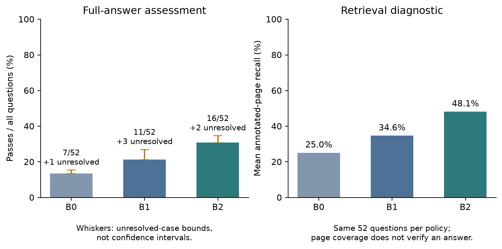

# Results and findings

## Frozen 52-question evaluation

The three policies ran on the same questions from 18 FY2022 annual reports. The original run produced 156 outputs. A retrospective assessor rated answer correctness, citation support and citation completeness. A supported pass required all three. An answer declined by the system or invalid under the output contract received no correctness credit.

| Policy | Correctness pass / fail / unresolved | Supported passes | Mean page recall | No / some / all annotated pages |
| --- | --- | ---: | ---: | --- |
| B0 | 7 / 44 / 1 | 6 | 25.0% | 37 / 4 / 11 |
| B1 | 11 / 38 / 3 | 10 | 34.6% | 31 / 6 / 15 |
| B2 | 16 / 34 / 2 | 14 | 48.1% | 23 / 8 / 21 |

B2 used 92 search rounds and 308,831 total input and output tokens. B1 used 104 rounds and 292,545 tokens. The extra model work is relevant even though B2 searched less often. Four more answers passed under B2 than B1. The paired interval includes zero, and the answer ratings have no measured human agreement. These are descriptive results for the saved run.

In FinanceBench question 03620, B2 correctly calculated USD 9,031 million from the selected numbers. It had chosen net income instead of operating profit and prior-year depreciation instead of current capital spending. The benchmark inputs give USD 9,068 million. The example shows how a relevant page and valid arithmetic can still produce an unsupported financial answer.

The [question-level export](evaluation_by_question.csv) preserves IDs, timings, token counts, page recall and final ratings. The [rubric](assessment_rubric.md) and [paired intervals](supported_intervals.json) explain how to interpret them. The [original run metrics](run_metrics.csv) also contain scores from an earlier automatic reference matcher. Use that metric for historical comparisons only. Its rules differ from full-answer and citation assessment.

## Development comparisons

On ten development questions, raising the evidence allowance from 2,000 to 8,000 tokens increased mean annotated-page recall from 45% to 80%. The older automatic matcher accepted seven answers in each configuration. The [development comparison table](development_comparison.csv) also records the model-size and parent–child retrieval comparisons. The development questions informed method selection and are separate from the 52-question evaluation.

## Scope for follow-up

A planned experiment will compare fixed and adaptive evidence allowances on previously unused filings at comparable total model-token use. The scoring rules will be defined before evaluation. The current results describe public filings in a Kaggle run. Local model execution was checked during development and private deployment remains untested.
